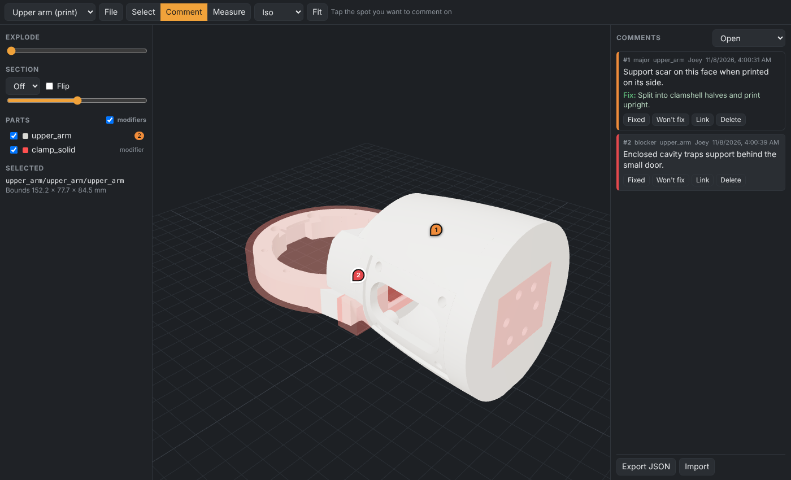

# TandemCAD

A browser app for reviewing 3D parts and assemblies: open a file, spin it around, explode it, cut a section, measure, and pin comments with suggested fixes on the exact spot of the exact part. Comments are plain JSON, keyed by part and file revision, so other people (or agents) can read them and act on them.



## What it does today (v0)

- **Opens** Bambu Studio / generic **3MF** (multi-file production extension, part names, modifier volumes and their per-part slicer overrides), **STEP** assemblies (full part tree, see below), **STL**, and **GLB/glTF**. Drag a file onto the page, use **File**, or list files in `public/library.json`.
- **STEP assemblies:** the local server converts a `.step` / `.stp` to GLB with OpenCascade ([tools/step2glb](tools/step2glb/README.md)), keeping every sub-assembly and part instance by its CAD name (`arm/upper_arm-1/bracket-2`). Explode moves sub-assemblies out as units, then spreads their parts; comments stick to the instance. Conversions are cached by file hash, and comments are keyed to the STEP's hash, so re-converting never orphans them.
- **View:** orbit / pan / zoom (mouse or touch), named views, fit, explode slider, section plane on X/Y/Z with flip, part tree with show/hide (double-click to isolate), modifiers toggle.
- **Measure:** tap two points, distance in mm.
- **Comment:** pick **Comment**, tap a spot on a part, write what's wrong, choose a severity (blocker/major/minor/note) and an optional suggested fix. Pins stay attached to that part, so they move with the explode. Mark comments fixed or won't-fix with a note, reopen, or copy a deep link (`#file=<path>&c=<id>`).
- **Revisions:** the app hashes every file it opens (SHA-256). Each comment records the revision it was written against and is flagged "older rev" once the file changes.
- Phone layout: Parts and Notes panels slide in from the sides.

Comments are stored in the browser (localStorage) for now, with Export/Import JSON. Saving straight into a git repo is next.

Keyboard: `S` select, `C` comment, `M` measure, `F` fit, `Esc` cancel.

## Comment format

One document per reviewed file. `part` is the node path inside the file; `anchor.p` / `anchor.n` are the point and face normal in that part's local coordinates (mm), so a pin survives the part being moved in an assembly.

```json
{
  "schema": 1,
  "file": "designs/arm/upper_arm.3mf",
  "comments": [
    {
      "id": "mw7b10s71cex",
      "part": "upper_arm/upper_arm",
      "anchor": { "p": [43.105, -16.86, 33.277], "n": [-0.089, -0.455, 0.886] },
      "severity": "major",
      "text": "Support scar on this face when printed on its side.",
      "fix": "Split into clamshell halves and print upright.",
      "status": "open",
      "author": "Joey",
      "created": "2026-11-08T04:00:31.543Z",
      "rev": "343b3a01a976b27121880ab823e57ccace0408a774690d262fec2b1de11ac7f7"
    }
  ]
}
```

`status` is `open`, `fixed` or `wontfix`; closed comments carry `resolved: { by, at, rev, note }`.

## Develop

```bash
npm install
pip install -r tools/step2glb/requirements.txt   # for STEP files (Python 3.10+)
npm run dev      # http://localhost:5173
npm run dev:lan  # same, reachable from a phone on the same Wi-Fi (http://<pc-ip>:5173)
npm run build    # static site in dist/ (STEP needs the server: npm run preview, or pre-convert)
npm run test:step
```

Over plain http on the LAN the phone isn't a "secure context": the app falls back to a JS SHA-256 for revisions, but browser features that need https (WebGPU, clipboard, service workers) stay off. For those, serve https (e.g. Tailscale `tailscale serve` or mkcert).

If the Python with `cadquery-ocp` isn't `python3` (`python` on Windows), set `TANDEM_PYTHON` to it.

Point the library at your own files with `public/library.local.json` (gitignored, same shape as `public/library.example.json`) and put the files under `public/samples/` (also gitignored).

## Roadmap

1. Save comments into the parts repo checkout through the local server (JSON per reviewed file, readable by any agent with `git pull`). Runs on your own PC for now; public hosting later.
2. Review sets: a manifest of files to review together, with a pass/fail per file.
3. Print-check overlays (thin walls, overhangs, stray bodies) and side-by-side revision diff.
